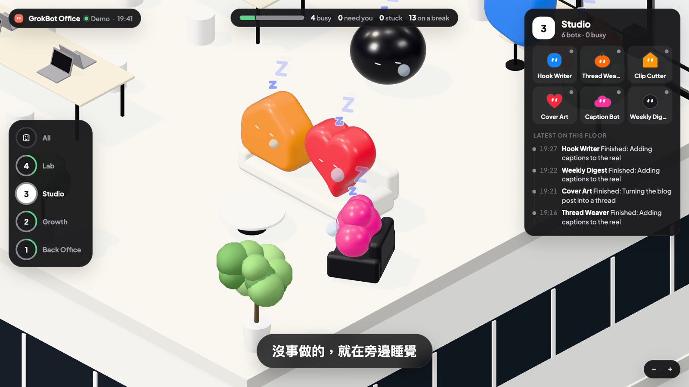

# GrokBot Office


A live 3D office for the bots in your **Grok Bot** desktop app. Every bot is its own little pet, in the same shape and colour you gave it in the app. The ones with nothing to do doze on the sofa, the busy ones type at their desks, and the ones that need you jump up and wave until you answer. One click opens that bot in Grok Bot so you can reply.

> **Credit.** The idea comes from [@0xCodila's GrokBot live dashboard](https://x.com/0xCodila/status/2116960213206966317): teams of bots shown as floors of a 3D office. That dashboard isn't open source. This is an independent, open-source take with its own code, models, layout and data source (it reads the Grok Bot app on your own Mac instead of asking the bots to report in).
>
> **Not affiliated with xAI, Grok or the Grok Bot app.** "Grok Bot" is used only to say which app this works with. The pets mirror the avatar shapes and colours the app lets you pick so your bots look familiar; everything is drawn from code in this repo.



## Run it

Needs Node.js 18+ and the Grok Bot desktop app on macOS. Nothing to install.

```bash
git clone https://github.com/Charonyuu/grokbot-office
cd grokbot-office
node bin/office.mjs
```

Open http://127.0.0.1:4321/. Your bots appear on their own.

`bin/office.mjs` reads the local cache the Grok Bot app keeps in `~/Library/Application Support/Grok Bot/` (roster, recent conversations, weekly usage) and pushes changes to the page. Point it elsewhere with `GROKBOT_DIR=...`, or change the port with `PORT=...`.

## What you see

| The pet is... | Because |
|---|---|
| asleep on the sofa, z's drifting up | nothing to do: its last reply is done |
| at its desk, laptop lit, typing | you asked something and it hasn't replied yet, or it just replied |
| standing and bouncing, yellow "?" | it is waiting on you: a choice card, a permission ask, a form, an email draft to approve, or a question |
| shaking with a red "!" | it is stuck |
| spinning on the spot | it just finished something |

- **Floors**: one floor per sidebar section in the app (everything else goes on "My bots"). Pick a floor on the lift panel; the floors above lift away.
- **Needs you**: bottom left, every bot waiting on you. Click one, then **Answer in Grok Bot** to jump straight to that conversation (`grokbot://agent/<id>`).
- **Today**: your plan's weekly usage, and which bots were most active this week.

## Quality

It sets itself: it starts at medium, watches how long frames take, steps down if they are slow and up to high when there is room. It draws 30 frames a second (60 while the camera moves, 10 when the window is in the background). Force a level with `?quality=high`, `?quality=medium` or `?quality=low` (`?lite` is the same as low).

## Without the app

- `?demo` runs a made-up team, so you can look around anywhere.
- `?topic=<ntfy topic>` reads status lines from an [ntfy](https://ntfy.sh) topic instead, for bots that report in themselves. [docs/grokbot-setup.md](docs/grokbot-setup.md) has a prompt that sets this up. Messages are one JSON line each:

```json
{"t":"roster","bots":[{"name":"Weekly Digest","team":"Studio","shape":"blob","color":"#FF9800"}]}
{"bot":"Weekly Digest","state":"working","task":"Collecting links"}
{"bot":"Weekly Digest","state":"waiting","task":"Send it now or Monday?"}
{"bot":"Weekly Digest","state":"done","task":"Sent the digest"}
```

## Privacy

Everything stays on your machine. The server only listens on 127.0.0.1, reads the app's cache read-only, and the page only ever shows bot names and short snippets of their last message. Nothing is sent anywhere.

## Known limits

- The Grok Bot app writes its local cache from time to time, not on every message, so the office can lag behind what you see in the app.
- The cache has no per-bot token counts, so "most active" counts replies; the plan's weekly usage is the app's own figure.

## 中文說明

把 Grok Bot 桌面版裡的 bot 變成 3D 辦公室裡的寵物：沒事做的在沙發上睡覺，忙的在座位上打字，需要你回覆的會站起來跳，點一下「Answer in Grok Bot」就跳回那個對話。執行 `node bin/office.mjs`，打開 http://127.0.0.1:4321/ 就好，資料只在你自己的電腦上讀取。

點子來自 [@0xCodila 的 GrokBot 即時儀表板](https://x.com/0xCodila/status/2116960213206966317)（未開源）；這是獨立的開源實作，程式、模型、版面和資料來源都是自己做的。與 xAI、Grok、Grok Bot 官方無關。

## See also

[**whatsmyagentdoing**](https://github.com/Charonyuu/whatsmyagentdoing) is the same idea for coding agents: type `/myoffice` and every Claude Code, Codex, Gemini CLI, Copilot CLI and Grok Build session on your machine shows up in a little office, thinking, running tools, or waiting for you. GrokBot Office grew out of it.

想看寫程式的 agent（Claude Code、Codex、Gemini CLI……）在做什麼，可以用同系列的 [whatsmyagentdoing](https://github.com/Charonyuu/whatsmyagentdoing)。

## Credits

- Idea: [@0xCodila](https://x.com/0xCodila/status/2116960213206966317)
- 3D: [three.js](https://threejs.org) (MIT), loaded from jsDelivr
- Fonts: Plus Jakarta Sans and Fredoka (SIL Open Font License), from Google Fonts

## License

MIT
