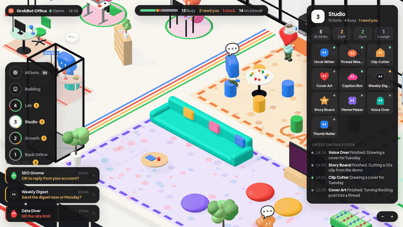
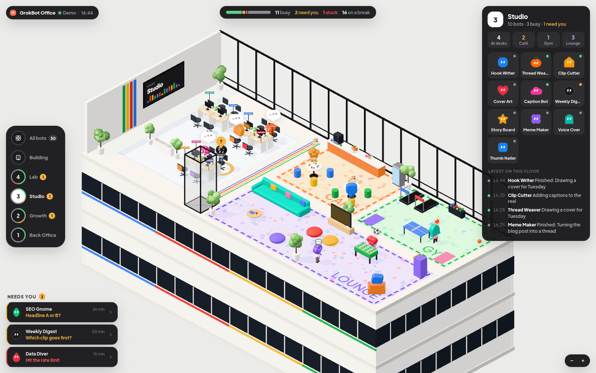
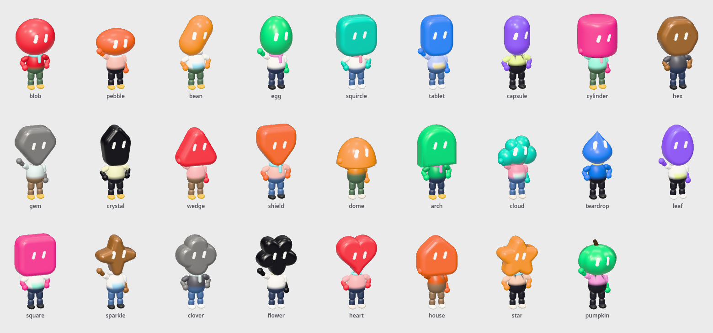
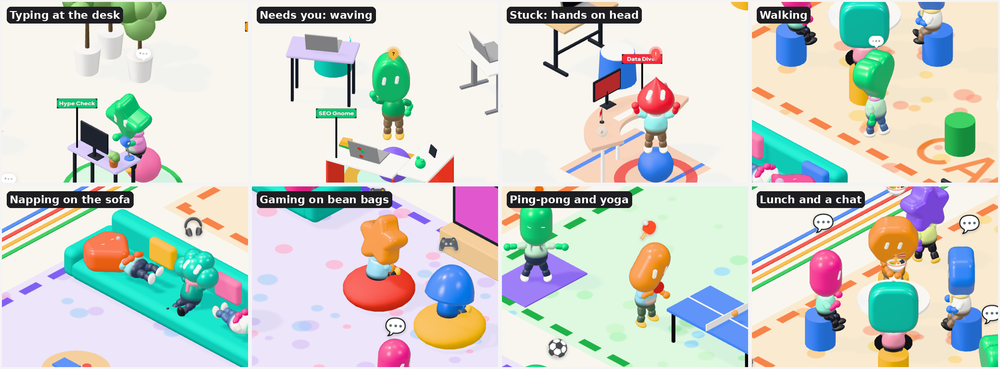
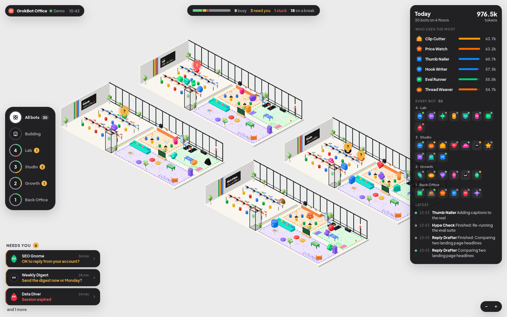

# GrokBot Office



A live 3D office for the bots in your **Grok Bot** desktop app. Every bot is a cute chibi with a big head and a little body, arms and legs. The head is the bot's avatar from the app, in the same shape and colour, pill eyes and all. Each one has its own named desk. The busy ones sit and type, the ones that need you stand on their chairs and wave until you answer, and the ones with nothing to do get up and wander a Google-style campus: a café, a gym and a lounge. One click opens that bot in Grok Bot so you can reply.

> **Credit.** The idea comes from [@0xCodila's GrokBot live dashboard](https://x.com/0xCodila/status/2116960213206966317): teams of bots shown as floors of a 3D office. That dashboard isn't open source. This is an independent, open-source take with its own code, models, layout and data source (it reads the Grok Bot app on your own Mac instead of asking the bots to report in).
>
> **Not affiliated with xAI, Grok or the Grok Bot app.** "Grok Bot" is used only to say which app this works with. The chibis' heads mirror the avatar shapes and colours the app lets you pick so your bots look familiar; everything is drawn from code in this repo.



### The chibis

Every avatar shape in the app becomes a head on a little body. The clothes are picked from the bot's id (a tee, a striped top, a hoodie, overalls or a scarf), tinted from its colour, so no two bots dress quite alike:



They move their arms and legs for everything they do. They walk with a stride and hop up onto their seats. At the desk they sit with their legs dangling and type. They wave when they need you and hold their heads when they're stuck. On a break they stretch out on the sofa, game with a controller, run on the treadmill, swing a ping-pong paddle, shoot hoops, hold yoga poses, eat from a bowl, sip coffee, chat with their hands and work the foosball rods:



`dev/pets.html` shows every shape side by side.

## Run it

Needs Node.js 18+ and the Grok Bot desktop app on macOS. Nothing to install.

```bash
git clone https://github.com/Charonyuu/grokbot-office
cd grokbot-office
node bin/office.mjs
```

Open http://127.0.0.1:4321/. Your bots appear on their own.

`bin/office.mjs` reads the local cache the Grok Bot app keeps in `~/Library/Application Support/Grok Bot/` (roster, recent conversations, weekly usage) and pushes changes to the page. Point it elsewhere with `GROKBOT_DIR=...`, or change the port with `PORT=...`.

### Is the office right about who's working?

The app's cache records messages, not the work in between: no tool calls, no browsing, no subagents. A bot that says "On it" and then works for twenty minutes leaves a transcript that has gone quiet. `bin/status.mjs` reads that quiet stretch as work, using the rules in the table below. To check them against the app:

```bash
GROKBOT_DEBUG=1 node bin/office.mjs     # prints every bot's state and why, then each change as it happens
```

Or open http://127.0.0.1:4321/?debug for a panel with the same list, or http://127.0.0.1:4321/api/debug for the JSON. Three settings let you tune the rules:

- `GROKBOT_GRACE_MIN` (default 8): how long a bot still counts as working after its last message.
- `GROKBOT_TURN_MAX_MIN` (default 50): the longest an unanswered message, an "on it", or a hand-off to another bot keeps it working.
- `GROKBOT_POLL_SEC` (default 5): how often the cache is re-read, on top of watching it for changes.

`node dev/fake-cache.mjs /tmp/fake --check` runs the rules on a made-up cache with one bot per case. Point the server at that cache with `GROKBOT_DIR=/tmp/fake` to see the same bots in the office.

## What you see

| The bot is... | Because |
|---|---|
| away from its desk in the café, gym or lounge | nothing to do: its last reply is done (it's on a break) |
| sitting at its desk, laptop lit, typing | it's working: you (or another bot) asked something and it hasn't answered yet, it said "on it" and is still going, it handed work to another bot that hasn't reported back, or it said something in the last 8 minutes |
| standing on its chair, bouncing and waving, yellow "?", yellow ring pulsing round the desk | it is waiting on you: a choice card, a permission ask, a form, an email draft to approve, or a question |
| shaking at its desk, hands on its head, with a red "!" and a red ring | it is stuck: its last task was stopped (for example the app's 50-minute limit for background tasks) |
| spinning and cheering with its arms up | it just finished something |

### Desks and break zones

Every bot on a floor has **its own standalone workstation** with a little flag showing its name in its colour. There are no long shared tables: desks are scattered in loose clusters with walking room between them, each turned its own way. Each one is different:

- **Desk**: wooden, round café table, L-shaped corner desk, standing desk (with a mat), curved desk or a pastel desk; a laptop or a monitor and keyboard.
- **Chair**: office chair, stool, exercise ball or pouf.
- **Decorations**, picked from the bot's id so they never change between visits: a plant, cactus, lamp, mug, plush, mini flag, photo frame, books, headphones, desk fan, fishbowl, trophy or donut, often a rug under the desk and stickers on the laptop.

A few spare spots become little nooks with plants, a bookshelf or a whiteboard. Floors grow to fit: there is always a desk for every bot, however many you have (the desk area gets more rows and columns). On low quality the decorations are left out to keep it fast.

The rest of each floor is laid out like a Google office:

| Zone | What bots on a break do there |
|---|---|
| ☕ **Café** | queue at the counter for coffee or a donut, eat and chat at the round tables |
| 🏃 **Gym** | run on the treadmills, rally at the ping-pong table, shoot hoops, do yoga |
| 🎮 **Lounge** | nap on the sofa (sleep bubbles and all), play video games on the bean bags or at the arcade, play foosball, chill and chat |

When a bot finishes, it gets up and **walks** (it never teleports) round the desks and furniture to a free spot. Every so often it wanders on to something else, usually in another zone. When it gets a new job it walks straight back to its desk and starts typing. Bots step aside for each other in the corridors and never share a spot. Over a bot, the little emoji says what it is doing; its card says it in words ("Playing ping-pong · Gym"), and a floor's card counts how many bots are at their desks, in the café, in the gym and in the lounge.

### Seeing all your bots

- **All bots** (top of the lift panel) lays every floor out side by side, all open, so every bot is in view at once. You can also open the page with `?all`.
- **Building** is the stacked tower; pick a floor to cut the building open there.
- The **Today** card lists every bot, floor by floor. Click one to find it.
- `bin/office.mjs` shows every bot you have, including bots hidden from the app's sidebar (they get a **Hidden** floor unless they are in a section). `GROKBOT_SIDEBAR_ONLY=1` shows only what is in the sidebar, as before; bots removed from the sidebar are left out unless you set `GROKBOT_ALL=1`.



- **Floors**: one floor per sidebar section in the app (everything else goes on "My bots"). Pick a floor on the lift panel; the floors above lift away. `?floor=<name>` opens on that floor.
- **Needs you**: bottom left, every bot waiting on you. Click one, then **Answer in Grok Bot** to jump straight to that conversation (`grokbot://agent/<id>`).
- **Today**: your plan's weekly usage, and which bots were most active this week.

## Quality

It sets itself: it starts at medium, watches how long frames take, steps down if they are slow and up to high when there is room. It draws 30 frames a second (60 while the camera moves, 10 when the window is in the background). Force a level with `?quality=high`, `?quality=medium` or `?quality=low` (`?lite` is the same as low).

## Without the app

- `?demo` runs a made-up company of 30 bots on four floors, about half of them on a break, so you can look around anywhere. `?demo&bots=60` pads it out to 60 bots (the extras share one big floor) to see a crowded office.
- `?topic=<ntfy topic>` reads status lines from an [ntfy](https://ntfy.sh) topic instead, for bots that report in themselves. [docs/grokbot-setup.md](docs/grokbot-setup.md) has a prompt that sets this up. Messages are one JSON line each:

```json
{"t":"roster","bots":[{"name":"Weekly Digest","team":"Studio","shape":"blob","color":"#FF9800"}]}
{"bot":"Weekly Digest","state":"working","task":"Collecting links"}
{"bot":"Weekly Digest","state":"waiting","task":"Send it now or Monday?"}
{"bot":"Weekly Digest","state":"done","task":"Sent the digest"}
```

## Privacy

Everything stays on your machine. The server only listens on 127.0.0.1, reads the app's cache read-only, and the page only ever shows bot names and short snippets of their last message. Nothing is sent anywhere.

## Known limits

- The Grok Bot app writes its local cache from time to time, not on every message, so the office can lag behind what you see in the app.
- The cache has no "running" flag, so "working" is a best guess from the messages (see above). A bot that finishes silently right after saying "on it" stays at its desk until `GROKBOT_TURN_MAX_MIN` runs out. One that works for a long time without saying "on it" goes on a break after `GROKBOT_GRACE_MIN`.
- The cache has no per-bot token counts, so "most active" counts replies; the plan's weekly usage is the app's own figure.
- All floors are the same size, sized for your busiest team, so smaller teams have some free desks.
- Break spots are shared first come, first served; when a floor has more bots on a break than spots, the extras stand and chat in open space.

## 中文說明

把 Grok Bot 桌面版裡的 bot 變成 3D 辦公室裡的可愛 Q 版小人：大頭、小身體，有手有腳，**頭就是 bot 在 app 裡的頭像**（同樣的形狀、顏色和眼睛），衣服（T 恤、條紋衫、帽 T、吊帶褲、圍巾）依 bot 自動搭配。每個 bot 都有自己的獨立座位（不是一整排長桌），桌上插著寫了名字的小旗子；忙的坐在座位上打字，需要你回覆的會站到椅子上跳、揮手，座位周圍亮起黃色光圈（卡住的會抱頭發抖，亮起紅色「!」），點一下「Answer in Grok Bot」就跳回那個對話。執行 `node bin/office.mjs`，打開 http://127.0.0.1:4321/ 就好，資料只在你自己的電腦上讀取。

**誰在工作？** app 的本機快取只記錄訊息，不記錄中間的工具執行、瀏覽和子代理，所以 bot 回了「收到／正在處理」後安靜做事的那段時間，舊版會誤判成休息。現在只要符合下面任一條件就算工作中，bot 會留在座位上：有人（你或其他 bot）傳訊給它但它還沒回；它最後回的是「收到／正在處理／稍等」這類短訊息（最多 50 分鐘）；它把工作交給別的 bot，對方還沒回報；它找來幫忙的 bot 還在做；它 8 分鐘內有發言。想核對的話，執行 `GROKBOT_DEBUG=1 node bin/office.mjs`（終端機會列出每個 bot 的狀態和原因），或打開 http://127.0.0.1:4321/?debug 。時間長度可以用 `GROKBOT_GRACE_MIN`、`GROKBOT_TURN_MAX_MIN`、`GROKBOT_POLL_SEC` 調整。

辦公室參考 Google 辦公室的配置，除了座位區，每層樓還有：

- ☕ **餐廳／咖啡區**：在吧台排隊拿咖啡、甜甜圈，坐在圓桌吃飯聊天
- 🏃 **運動區**：跑步機、桌球、投籃、瑜珈墊
- 🎮 **休閒區**：沙發上睡午覺、懶骨頭打電動、大型機台、手足球、聊天

座位一個個分開擺放、方向各不相同，中間留走道。桌子有木桌、圓桌、L 型桌、站立桌、弧形桌、粉彩桌，椅子有辦公椅、高腳凳、瑜珈球、懶骨頭坐墊；每個座位依 bot 固定配上不同的裝飾：盆栽、仙人掌、檯燈、馬克杯、娃娃、小旗、相框、書、耳機、小電扇、魚缸、獎盃、甜甜圈，還有地毯和筆電貼紙。空位會擺上植物、書架或白板。低畫質時會省略裝飾以保持流暢。

bot 閒置時會離開座位，**走路**（擺手邁步，不是瞬移）到這些區域找空位活動：躺在沙發上睡午覺、拿手把打電動、跑步機上跑步、揮桌球拍、投籃、做瑜珈、捧碗吃飯、喝咖啡、比手畫腳聊天、轉手足球桿，過一陣子會換到別的區域；一接到工作就走回自己的座位開始打字。頭上的小圖示會顯示它正在做什麼，點開 bot 卡片也會寫出來（例如「Playing ping-pong · Gym」）。

想一次看到全部的 bot：按電梯面板最上面的 **All bots**（或網址加 `?all`），所有樓層會攤開並排顯示；右側 Today 卡片也會列出每一個 bot。人數再多，座位區也會自動加排、加列，保證每個 bot 都有位子。側邊欄裡隱藏的 bot 也會顯示（放在 Hidden 樓層）；只想看側邊欄的 bot 可設 `GROKBOT_SIDEBAR_ONLY=1`。用 `?demo` 可以看 30 個 bot 的示範，`?demo&bots=60` 可以看更擠的辦公室。

點子來自 [@0xCodila 的 GrokBot 即時儀表板](https://x.com/0xCodila/status/2116960213206966317)（未開源）；這是獨立的開源實作，程式、模型、版面和資料來源都是自己做的。與 xAI、Grok、Grok Bot 官方無關。

## See also

[**whatsmyagentdoing**](https://github.com/Charonyuu/whatsmyagentdoing) is the same idea for coding agents: type `/myoffice` and every Claude Code, Codex, Gemini CLI, Copilot CLI and Grok Build session on your machine shows up in a little office, thinking, running tools, or waiting for you. GrokBot Office grew out of it.

想看寫程式的 agent（Claude Code、Codex、Gemini CLI……）在做什麼，可以用同系列的 [whatsmyagentdoing](https://github.com/Charonyuu/whatsmyagentdoing)。

## Credits

- Idea: [@0xCodila](https://x.com/0xCodila/status/2116960213206966317)
- 3D: [three.js](https://threejs.org) (MIT), loaded from jsDelivr
- Fonts: Plus Jakarta Sans and Fredoka (SIL Open Font License), from Google Fonts

## License

MIT
